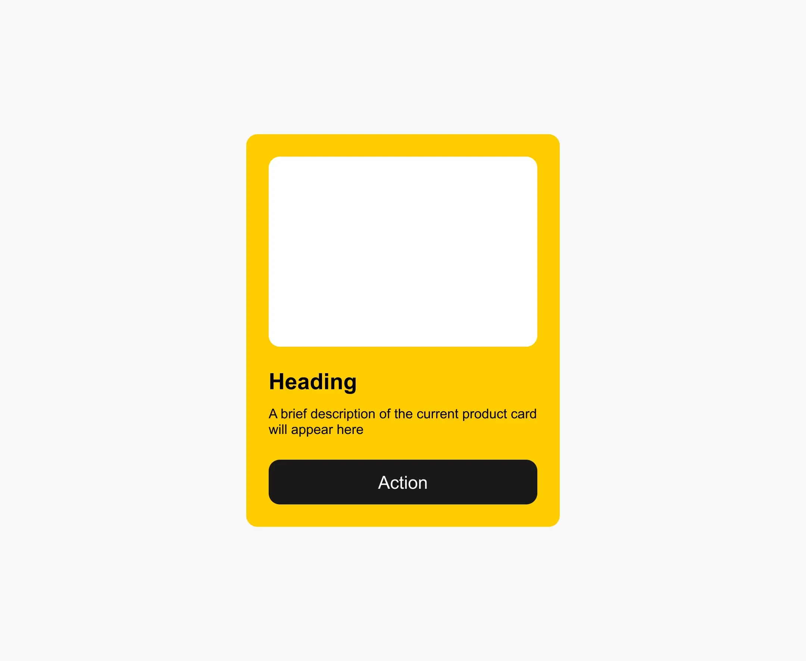

# 🕵️ Практика к лекции «Синтаксис CSS и специфичность»

- **Уровень:** базовый
- **Время:** 45 минут
- **Лекция:** «Синтаксис CSS и специфичность» <!-- TODO: ссылка на лекцию в блоге -->
- **Макет:** [открыть в Figma](https://www.figma.com/design/cc25xgproOvaitb2qOgv6P/hexlet?node-id=717-2&t=fnC5G3hN5QKwT5TX-1)




## 🎯 Цель

Вы стилизуете шаблонную карточку по макету из Figma и на практике закрепите три вещи:

- подключение стилей внешним файлом;
- создание селекторов по классу;
- учёт специфичности без использования `!important`.

Базовая HTML-разметка готова (файл `src/index.html`). Ваша задача дополнить её семантическими тегами, опираясь на дизайн-макет, подключить и написать файл со стилями (`src/styles.css`).

## 🚀 Как начать

1. Нажмите зелёную кнопку **Use this template** → **Create a new repository**.
2. Назовите репозиторий `css-practice-01-product-card` и создайте его в своём аккаунте.
3. Склонируйте свой репозиторий и перейдите в папку проекта:

   ```bash
   git clone https://github.com/<ваш-логин>/css-practice-01-product-card.git
   cd css-practice-01-product-card
   ```

4. Откройте папку проекта в VS Code.
5. Откройте новый терминал (`bash`) и проверьте, установлен ли **Node.js**:

   ```bash
   node --version    # v20.x.x — если установлен
   ```

   Если команда не найдена — скачайте **Node.js** с [nodejs.org](https://nodejs.org) (версия LTS).

   После этого выполните следующие команды

   ```bash
   npm install       # установить зависимости для проекта
   npx biome check   # линтер для проверки качества кода
   ```

6. Откройте `src/index.html` в браузере: двойным кликом по файлу или через расширение Live Server.

Пока стили не подключены, карточка выглядит как обычный текст с серой кнопкой. Так и должно быть.

## 🗂 Что в проекте

```bash
css-practice-01-product-card/
├── .github/                    # CI runners
├── .gitignore                  # что не попадает в репозиторий
├── LICENSE                     # лицензия
├── README.md                   # описание проекта
├── .editorconfig               # единые отступы и кодировка для редактора
├── biome.json                  # настройки линтера
├── design/
│   └── layout.webp             # дизайн задания 
├── package-lock.json           # точные версии зависимостей
├── package.json                # команды и зависимости проекта
├── src
│   ├── index.html              # разметка карточки 
│   └── styles.css              # здесь вы пишете стили
└── tests/                      # базовые тесты
```

После `npm install` появится папка `node_modules/` с установленными пакетами. Она не попадает в репозиторий.

В начале `src/styles.css` есть **базовый блок**: стили страницы и кнопки. Его не меняйте — свои стили пишите ниже строки `Ваши стили — ниже этой строки`.

## 🤹 Что нужно сделать

### Шаг 1. Подключите стили

В `src/index.html` найдите комментарий `<!-- Шаг 1: подключите здесь файл styles.css -->` и замените его тегом, который подключает стили. После сохранения шрифт на странице сменится на Arial — значит, файл подключился.

### Шаг 2. Разметка карточки

Допишите файл `src/index.html`, заменив теги на верные и добавьте необходимые классы.

### Шаг 3. Стилизация карточки

1. Оформите `.card`: ширина, внутренний отступ, белый фон и скругление углов. Значения берите из макета Figma.
2. Оформите `.card-image`: высота, цвет фона и скругление. Это цветная заглушка на месте будущей картинки. Работу с изображениями разберём позже.
3. Задайте размер шрифта и цвет для `.card-title` и `.card-subtitle`.
4. Оформите `.card-button`: ширина на всю карточку, высота, цвета, размер шрифта, без рамки, со скруглением.

Обратите внимание: в базовом блоке у кнопки уже есть серый фон, заданный через тег `button`. Ваше правило с классом должно его перебить. Подумайте, почему для этого **не нужен** `!important`.

> Управлять отступами между заголовком, описанием и кнопкой мы научимся на следующей лекции.

Если сейчас это вызывает трудности, оставьте значения по умолчанию.

## 📋 Требования

Работа принимается, если выполнены все пункты:

1. Стили подключены внешним файлом в `<head>`.
2. В `index.html` нет атрибутов `style` и тега `<style>`.
3. В `styles.css` нет `!important`.
4. Базовый блок в начале `styles.css` не изменён.
5. Карточка `.card`: ширина 280px, внутренний отступ 20px, фон `#FFCC00`, скругление 10px.
6. Блок `.card-image`: высота 170px, фон `#FFF`, скругление 10px.
7. Заголовок `.card-title`: размер 20px, жирный, цвет `#000`.
8. Описание `.card-subtitle`: размер 12px, цвет `#000`.
9. Кнопка `.card-button`: на всю ширину карточки, высота 40px, фон `#000`, белый текст 16px, без рамки, скругление 10px.
10. Стили кнопки заданы через класс `.card-button`, а не через тег `button` или id.
11. Команда `npm run lint` завершается без ошибок.

## ✅ Как проверить себя

**Линтер.** Запустите проверку кода:

```bash
npm run lint
```

Если линтер нашёл только ошибки форматирования (отступы, переносы), исправьте их автоматически:

```bash
npm run format
```

Остальные ошибки исправляйте вручную. Например, `!important` линтер не уберёт сам — подумайте, как обойтись без него.

## 📤 Как сдать работу

1. Убедитесь, что `npm run lint` завершается без ошибок.
2. Сделайте коммит и отправьте изменения в свой репозиторий:

   ```bash
   git add .
   git commit -m "Стилизация карточки товара"
   git push
   ```

3. Проверьте, что изменения видны на GitHub.
4. Отправьте ссылку на свой репозиторий преподавателю тем способом, который принят в вашей группе.

## 🦾 Источники

- [Основы CSS — MDN](https://developer.mozilla.org/ru/docs/Learn_web_development/Getting_started/Your_first_website/Styling_the_content)
- [Специфичность — MDN](https://developer.mozilla.org/ru/docs/Web/CSS/Guides/Cascade/Specificity)
- Шрифт — Arial, системный, подключать его не нужно. Изображений в задании нет.
